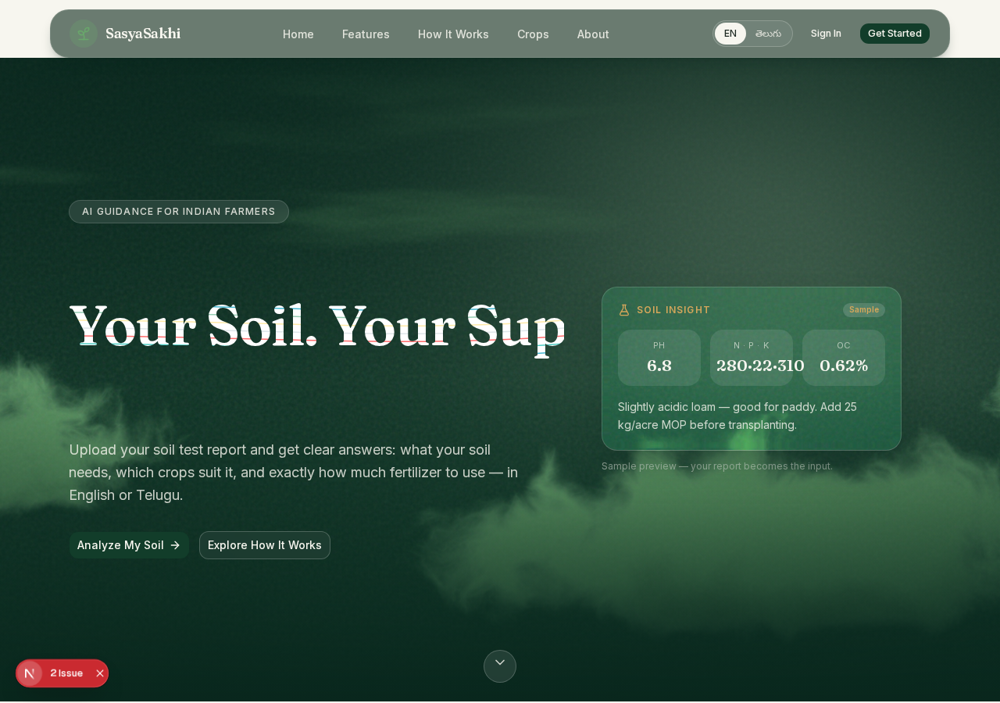

# SasyaSakhi

**Your Soil. Our Support. Better Farming.**

SasyaSakhi is a farming assistant for Indian farmers (Telugu/English),
built as a hackathon prototype. A farmer uploads a soil report, the system reads its
values, the farmer confirms them, and the app gives soil analysis, crop suitability
(paddy, cotton, chilli), fertilizer doses and costs, weather, a crop calendar, and a
Telugu/English assistant. A season tracker follows the chosen crop until harvest
and feeds that history into the next recommendation.



> This is a prototype demo. All demo values are labelled as demo. Fertilizer numbers
> are illustrative — confirm with your agriculture officer.

## Folder structure

```text
sasyasakhi/
  README.md            <- this file
  frontend/            <- Next.js 16 + TypeScript + Tailwind web app (Team 2)
  backend/             <- Python FastAPI API: OCR, analysis, recommendations
  data/                <- master copy of the Team 1 dataset workbook
  previews/            <- screenshots of the app
```

## Screenshots

| Screen | File |
|---|---|
| Landing | `previews/landing.png` |
| Dashboard | `previews/dashboard.png` |
| Soil report upload | `previews/soil-report.png` |
| Recommendations | `previews/recommendations.png` |
| Landing (phone size) | `previews/landing-mobile.png` |

### `frontend/`

The web app: landing page, login/signup, dashboard, soil-report upload and review,
soil analysis, crop recommendations, AI assistant, weather, crop calendar, settings.
It runs on mock data by default, so it works even without the backend. To use the
real backend, set `NEXT_PUBLIC_API_URL` (see below).

### `backend/`

The API server: real OCR for PDF/image soil reports (Tesseract), soil analysis and
crop suitability from the Team 1 workbook, STCR-based fertilizer calculations,
satellite soil estimates (ISRIC SoilGrids), live weather (Open-Meteo), and a
fertilizer schedule for season tracking. API docs are served automatically.

Key endpoints (after starting the backend):

- `GET /api/health` — service + dataset readiness check
- `POST /api/soil-reports/extract` — upload a PDF/image, run OCR
- `POST /api/soil-analysis` — analyse confirmed values
- `POST /api/recommendations/crops` — crop suitability
- `POST /api/recommendations/fertilizer` — fertilizer doses from STCR rules
- `POST /api/assistant/chat` — Telugu/English explanation
- `GET /api/soil/satellite?lat=&lon=` — satellite soil estimate
- `GET /api/weather/live?lat=&lon=` — live weather + rain advisory
- `GET /api/tracking/fertilizer-schedule?crop=&n_kg_ha=` — season schedule
- `GET /api/demo/sample-report` — labelled demo data

Full docs: open `http://localhost:8000/docs` after starting the backend.

### `data/`

Master copy of the Team 1 workbook:

- `SoilSaathi_ML_Crop_Nutrient_Datasets_800Rows.xlsx`

**Do not rename this file.** The backend loader looks for this exact filename
(it also accepts `SoilSaathi_Prototype_Ready_Dataset.xlsx`). The backend already
contains its own copy under `backend/data/`; `data/` here is the master copy for
reference and for replacing the backend copy if needed.

## Run on Windows (laptop)

You need Node.js 20+ and Python 3.11+ installed.

### 1. Backend (run this first)

```bat
cd sasyasakhi\backend
copy .env.example .env
py -m venv .venv
.venv\Scripts\activate
pip install -r requirements.txt
uvicorn app.main:app --reload --port 8000
```

Check it works: open `http://localhost:8000/api/health` in a browser. It should
report the dataset as loaded.

**Tesseract (needed for real OCR):** install Tesseract for Windows
(UB-Mannheim build from GitHub), then either add it to your system PATH or set
this line in `backend\.env`:

```ini
TESSERACT_CMD=C:\Program Files\Tesseract-OCR\tesseract.exe
```

Without Tesseract, uploads fall back to PDF text extraction only and OCR tests
are skipped — everything else still works.

### 2. Frontend

```bat
cd sasyasakhi\frontend
npm install
npm run dev
```

Open `http://localhost:3000`. By default the frontend talks to the backend at
`http://localhost:8000`. To point it elsewhere, create `frontend\.env.local`:

```ini
NEXT_PUBLIC_API_URL=http://localhost:8000
```

### 3. Run backend tests (optional)

```bat
cd sasyasakhi\backend
.venv\Scripts\activate
pytest -q
```

## Notes

- No secrets are stored in this package. `.env` is not included — create it from
  `.env.example`. Never commit a real `.env` or API key.
- The satellite endpoint returns modelled estimates, not lab measurements, and
  SoilGrids has no phosphorus/potassium data plus coverage gaps over some
  Indian cities — the endpoint says so plainly instead of guessing.
- The season tracker uses only dataset values (fertilizer splits by crop stage).
  Exact days-after-sowing timings are not in the dataset yet and are not invented.
- Previous name: this project was called SoilSaathi. Display text was renamed to
  SasyaSakhi; internal identifiers, logger names, and the dataset filename were
  deliberately left unchanged so nothing breaks.
